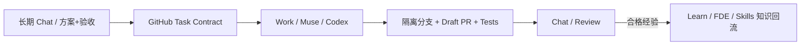

# 学习笔记｜给每个工程项目安排 Chat 与 Work，最大的难题不是命名

> 2026-11-02 · 来源：实际 ChatGPT 会话截图、XSA Case 003、GitHub 只读仓库/PR 盘点。此文是工程实践观察，不是自动绑定已部署说明。可用于后续公众号/开源文章改写。

## 为什么开始这样做

随着行途拥有 XSA、FDE、Harness、Skills、Learn、内容生产等多类开源/私有工程，长会话里任务混杂；新 Work 不认识原上下文；Muse、Codex 与 ChatGPT 各有自己的执行能力和授权边界。

用户把会话标题固定成 `XSA (chat)｜Super Agent 工程总控`、`XF (chat)｜FDE 知识与工程实践`，希望后续所有项目能清楚区分 Chat（讨论与决策）与 Work（实施与交付），并通过 GitHub 储存真正的成果。

**最重要的转折**：不是机械地为每个仓开两个新会话，而是把真正需要协作的专业项目建立主 Chat，Work 按具体任务临时创建，GitHub 持续记录权威任务和工作状态。

## 一次可复查的冲突

2026-11-02：`xingtu1996/xingtu-fde` 已实际存在（public）。仓内并行出现 [PR #1](https://github.com/xingtu1996/xingtu-fde/pull/1) 和 [PR #2](https://github.com/xingtu1996/xingtu-fde/pull/2)，变更文件大量重叠：README、AGENTS、知识地图、案例、来源登记等。各 Agent 可能都在正确执行自己的提示词，却因没有跨会话 task ownership，形成重复建设。

另一次 UI 截图显示左侧标题 `XSA (work)`，实际 Work 任务文本声明 `XF (work)`，模型选择器显示 GPT-6.1 Sol / 高，Work 显示正在执行/重连。标题错误不代表实际写错仓，但它证明了不能把 UI 标题当项目鉴权与路由依据，也不能从进度状态推断交付完成。

## 三层身份和两种证据

1. **导航身份**：`PROJECT (chat|work)｜专业职责`，让人快速找到会话。
2. **执行身份**：`task_id + project + primary_repo + owner + branch + write_scope + approval_scope`，决定交给谁、写哪里、可做什么。
3. **证明身份**：GitHub Issue/Commit SHA/Draft PR/测试/审批记录，是“是否完成”的可追溯凭证。

当任务正文与标题不符，应提示修正绑定，不允许凭猜测跳仓操作。

## 模型选型也应是一份策略，而不是信仰（2026-11-02 更新）

用户在看到真实 XF Work Sol/High 执行与 Plus 额度限制后明确纠偏：**行途所有专业 Work/Codex 优先采用 GPT-6 Luna · Medium，专业 Chat 采用 GPT-6 · Medium**。不要再默认按仓库分配 Sol/Terra/Astra，更不要全部用 High。对需要更长额度的用户，Pro 等高额度套餐可按复杂度升级 Sol/Astra，但并非必须升级，也非无限额度。

- Luna Medium 是统一基线；明确重复/低风险小任务可 Low；真正复杂故障、跨仓架构与安全难题，经输入与权限排查后可尝试 High 或临时选择更强模型。
- 各界面可用模型及努力级别可能不同；提示词的推荐并不能替代实际选择、权限或子 Agent 支持。
- Work/Codex 使用量按套餐共享机制计量；推理强度高不保证质量更好。无真实账户 Usage 时一律记 unknown。
- **保留历史证据**：本轮真实 XF Work 主代理 Sol/High、子代理 Sol/Medium 的记录是过去执行事实，不是新方案预设。
- 初步验证要比的是「每个验收通过的产物」所需的时间、额度、人工干预与缺陷，而不只是消息数。

参考：[官方 Work / Codex](https://help.openai.com/en/articles/20001275-chatgpt-work-and-codex)、[官方用量与努力级别](https://help.openai.com/en/articles/20001516-managing-usage-with-gpt-6-astra-in-work-and-codex)。

## 最小化流程

**必要的启动前检查**：仓库 README/AGENTS、已有 PR、相同文件范围的 Agent 是否在写、执行模型是否真实可用、权限及审批范围；检查后才能进入写操作。

## 三项可复现实验

1. 新 Work 不读原始聊天，只用 XSA 模板读取 GitHub 文件，是否能准确恢复项目职责？
2. 同一个 FDE 目标同时给两个 Agent：只读检测文件重叠，是否能暂停后启动的重复写入并提示 owner？
3. 用相同任务比较 Luna Medium 与 Luna High（若 UI 支持；必要时与 Sol Medium 对照）的成功率、测试通过率、人工介入次数及实际 usage。不给未经测量的节省百分比。

## 开源落点

- [XSA Convention v1（待审核）](https://github.com/xingtu1996/xingtu-super-agent/blob/governance/repo-bound-conversations-routing-v1-20261102/docs/governance/CONVERSATION_CONVENTION_V1.md)
- [XSA Model Routing v1](https://github.com/xingtu1996/xingtu-super-agent/blob/governance/repo-bound-conversations-routing-v1-20261102/docs/governance/MODEL_ROUTING_POLICY_V1.md)
- [XSA Work 初始化模板](https://github.com/xingtu1996/xingtu-super-agent/blob/governance/repo-bound-conversations-routing-v1-20261102/templates/WORK_SESSION_BOOTSTRAP.md)
- [XSA Repo 绑定索引](https://github.com/xingtu1996/xingtu-super-agent/blob/governance/repo-bound-conversations-routing-v1-20261102/registry/project-conversations.v1.yaml)
- [已观察的 Case 003](https://github.com/xingtu1996/xingtu-super-agent/pull/5)

## 可用于公开创作的总结

> 为 AI 会话命名，是让人看得清楚；给任务绑定仓库、责任人和审批范围，才是让 Agent 做得正确；用 GitHub PR 和测试留下证据，才是让成果真实可交付。

后续真正实现自动 Session Binding 之前，只能称为**治理规范与半人工工作流**，不能宣称已具备自动跨产品接力。
